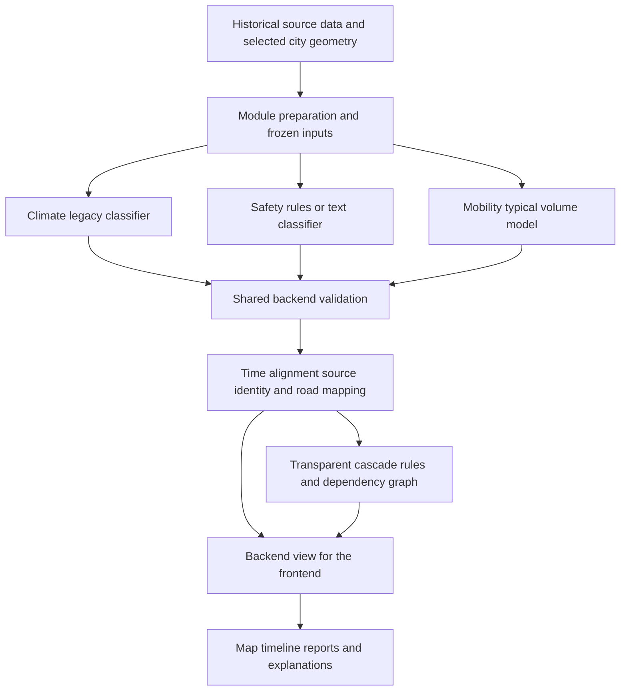

# Plexa project handbook

**Current checkout:** mobility was migrated to the cloned repository on 2026-10-28.
Use the [mobility README](../../backend/src/plexa/mobility/README.md) for current
paths and commands. Other domain descriptions below reflect the dated evidence
basis, not a fresh review of teammates' branches. Historical handover/reference
paths are retained as plain text when that material is absent from this checkout.

**Project:** Plexa A Multi Modal Smart City Digital Twin and Cascading Resilience Engine  
**Audience:** Anas, Kaleem, Arbaz, supervisors and AI assistants joining the project  
**Edition:** knowledge package v0.1, assembled 2026-10-18  
**Evidence basis:** local module reviews from 2026-10-15 and 2026-10-16, supplied
source materials, saved evaluation artifacts, and decisions made by Anas in the
planning discussion. Packaging this handbook does not establish new model results.

This handbook explains the project in enough depth for someone to join without
reading the planning chat. It connects the original purpose, the actual modules,
their scientific meanings, the integration architecture and the team's way of
working. The immediate objective is to make the supplied modules understandable,
reproducible and ready to connect for a bounded Hurricane Ida demonstration.

Read it with the [integration contract](../integration/integration_contract_v0.1.md)
for exact message fields, the [decision record](plexa_decisions_and_status.md) for
what is settled, and the [team and AI guide](plexa_project_handbook.md#16-decisions-and-knowledge-across-chats) for using
this knowledge in separate working chats. The handbook explains the system; the
contract defines the module exchange format. Contract v0.1 remains a reviewable
technical draft. This package does not record acceptance by every teammate.

## 1. The problem Plexa addresses

An urban disruption can affect more than the department that first observes it.
For example, heavy rainfall and flooding reports may matter to public works,
road access and emergency movement at the same time. When their data remains in
separate systems, a user must manually work out which places, times and services
are connected. A unified map alone does not explain those connections.

Plexa's research and engineering objective is to bring domain information into a
shared representation, examine possible effects across domains, and explain the
results through a frontend. Its distinctive component is the cascading engine:
the part that records dependencies and follows an initial disruption through
them. Useful outputs should answer where a signal came from, what it means,
which connected assets it could affect, and why the system displayed that effect.

The intended audience in the original proposal includes municipal planners,
emergency services, transportation authorities and utility/public works teams.
Residents are potential beneficiaries and contributors of reports. These are
intended stakeholders; no deployment with these organizations has been established
in the supplied project materials.

For this final year project, success begins with a coherent, explainable software
prototype and a demonstration to the supervisor. Feedback should guide subsequent
model and application improvements. Model complexity is useful only when its
inputs, evaluation and contribution to the system are clear.

## 2. The broader vision and the current scope

The original proposal describes a digital twin that combines structured urban
measurements with unstructured reports. It proposes domain prediction, a graph
of dependencies and a dashboard that supports mitigation planning. A digital twin
here means a software representation of selected city assets, their states and
their connections. The fidelity of that representation depends on the data and
models actually supplied.

The original documents discuss five conceptual domains. The current work is
organized into three supplied module folders and one planned energy workstream:

| Conceptual domain | Present workstream | Current meaning |
| --- | --- | --- |
| Mobility and transit | Mobility, owned by Anas | Typical hourly road traffic volume |
| Environment and climate | Climate, owned by Kaleem | Legacy flooding-report proxy; corrected preparation under development |
| Infrastructure and energy | Energy, to begin under Kaleem | Target and data contract still to be defined; no supplied model |
| Public safety | Combined safety/governance, owned by Arbaz | Classification or rule selection of hazard reports |
| Citizen governance | Combined safety/governance, owned by Arbaz | Report enrichment and retrieval of related flood guidance |

The safety work currently supplied is not a verified NYPD crime-risk surface.
Structured NYC 311 records and separate citizen text are different inputs. The 311
path uses category and descriptor fields; the project does not have a guaranteed
stream of free-form citizen complaint text from that source.

The master context mentions ST-GNNs, time-series transformers, LLMs, Neo4j,
FastAPI, Docker and several frontend options. Those names describe an earlier
architecture proposal. The actual supplied models are simpler and are described
below. Choice of a library or database does not establish that a capability has
been implemented. Earlier claims about other platforms or research gaps have not
been independently checked as part of this local planning work.

Anas selected a **bounded static demonstration using Hurricane Ida in 2021**.
That means using a frozen subset of inputs and replaying the same scenario
reliably. The initial work emphasizes consistent module packages and integration
readiness. Live operation, broad city coverage, learned cascade prediction,
energy-network simulation, 3D presentation and operational routing need their
own later data and validation.

## 3. Team ownership and decisions

| Person | Accountable for | Shared work |
| --- | --- | --- |
| Anas | Project leadership, mobility, all backend development, cascading engine and integration | Agrees shared interfaces with affected module owners |
| Kaleem | Climate preprocessing, models, inference and handover; beginning energy | Frontend with Arbaz |
| Arbaz | Safety/governance data processing, classifiers/rules, enrichment and handover | Frontend with Kaleem |

Module ownership includes knowing what the target means, preparing the required
features, documenting dependencies and producing a repeatable prediction/export.
Anas should receive a module he can call or consume, rather than having to infer
missing preprocessing from notebooks. Anas owns how independently produced
signals are normalized, joined and exposed by the shared backend.

Kaleem and Arbaz can choose implementation details within their modules. A change
that affects shared inputs, outputs, units, identity, timestamps or meaning is
discussed with Anas and the other affected owner before becoming the interface.
Frontend work consumes backend results and preserves their meaning. It should
not introduce a separate interpretation of climate scores, hazard confidence or
traffic volume.

This planning chat coordinates scope and agreements. Anas's mobility chat handles
mobility work. Cascading and other implementation work can use separate chats.
Those chats need the same documents explicitly; this package is the mechanism for
sharing project knowledge between them. No assistant can make a decision binding
on another teammate merely by writing it in its own chat.

## 4. The system architecture

The logical architecture has four stages. They describe responsibilities and data
flow, rather than a requirement to launch four services immediately.



First, preparation converts source data into the form each model needs. Climate
needs engineered terrain and rainfall features. Mobility needs calendar and road
context, plus the serving model's permitted history. Safety needs structured 311
fields or cleaned text and NLP assets.

Second, each domain package produces its own result. A model score keeps its
target meaning. A rule-based report selection keeps its rule identity. A volume
estimate keeps its unit and interval. Modules can run separately, which allows
their incompatible environments to remain isolated during initial integration.

Third, the backend checks versions, validates records and maps native locations
onto a reviewed common road representation. The cascading engine uses eligible
signals and declared dependency rules. Validation and spatial alignment are
shared infrastructure; they do not belong in independent frontend joins.

Fourth, the frontend receives a prepared backend view containing domain signals,
derived effects, provenance and availability states. The UI helps a viewer inspect
why an effect was produced. The shared backend, cascading engine and frontend
implementations were not present in the reviewed workspace.

## 5. Mobility in depth

### Purpose and observation unit

The mobility module estimates **typical vehicles per hour**. Its prepared model
table contains **1,412,050 eligible observations**. A modeling identity includes
road segment, travel direction, road type and UTC hour. The road identifiers come
from LION. Calendar interpretation uses America/New_York while a UTC key preserves
the instant, including distinctions that local clock strings can lose.

Traffic volume is a count/rate of vehicles observed or expected over an hour.
Speed, congestion, road capacity and incidents are different quantities. A low
traffic count can have several explanations; the current target alone cannot
identify which one applies. Flood effects on movement therefore require separate
rules or future data rather than a renamed volume prediction.

### Data preparation and preservation

Database checks, the modeling table and split assignments have been completed.
Versioned datasets remain in Parquet under `modules/mobility/data/clean/`.
Anas explicitly agreed that they do not need to be copied to PostgreSQL without
a concrete requirement. The database remains useful where its existing tables
and spatial queries are needed; storage decisions follow the access pattern.

Preprocessing preserves missing road attributes and records source provenance.
Features include calendar information, holiday indicators, LION attributes,
coordinates and source context. Fields describing full-dataset coverage are
diagnostics, rather than valid substitutes for training-only history. A future
serving fit must explicitly define source context, the COVID flag, category
handling and the history permitted for the requested date.

### Three evaluated models

**B1 global profile** estimates the 10th, 50th and 90th volume percentiles from
weekday/hour patterns, with fallback levels for sparse groups. It is the simple
reference against which richer models are evaluated.

**B2 road-scaled profile** combines a shared profile with road-specific level and
hourly shape, using shrinkage where history is limited. Its intervals use grouped
out-of-fold residuals from training. This makes history usage explicit and avoids
using a test road's observed targets to build its own predictors.

**B3 LightGBM quantile regression** fits three models for the 10th, 50th and 90th
quantiles of log-transformed volume. It uses road/calendar attributes and a
history profile derived from B2. The saved procedure handles missing attributes,
learns categories on training only, orders the quantiles and converts predictions
back to vehicles/hour. It uses fixed settings; the test set was not used for
subsequent tuning.

### Evaluation and what the results establish

Four independent evaluation scenarios test different questions. They are not four
parts of one combined split. Held-out days ask about unseen dates on known roads.
Unseen roads withhold complete road segments. The chronological scenario trains
through 2018 and tests from 2019 on eligible roads. The small season-transfer
check trains on autumn and tests same-year summer; its ordering makes it a
retrospective sensitivity check rather than a future forecast.

| Evaluation | B1 MAE | B2 MAE | B3 MAE | B3 nominal 80% interval coverage |
| --- | ---: | ---: | ---: | ---: |
| Held-out days | 325.833 | 117.195 | 81.216 | 82.8% |
| Unseen roads | 352.653 | 314.213 | 201.630 | 71.3% |
| Chronological later years | 196.012 | 102.932 | 107.274 | 57.4% |
| Autumn to summer sensitivity | 269.650 | 124.405 | 65.778 | 68.5% |

MAE is in vehicles/hour and metrics weight road/direction units equally. These
are saved benchmark results from the workspace, not a new training run for this
handbook. B3 improves unseen-road point predictions over B1 by about 42.82%, but
misses the pre-agreed coverage range of 75–85%. B2 has slightly lower chronological
MAE than B3; B2's chronological interval coverage is also low, about 66.3%.

An 80% interval is a nominal objective. A coverage value of 57.4% means the
interval contained the observed target in that proportion of the weighted test
evaluation. It is not an 80% guarantee for every displayed road. A serving-model
choice must consider its intended use and preserve these limitations.

Saved models, predictions, metrics and local MLflow records exist. A final serving
fit, a stable prediction entry point and an API remain to be developed in Anas's
mobility workstream. Evaluation fits must not be silently relabeled as a final
historical Ida deployment.

Sources: [mobility README](../../backend/src/plexa/mobility/README.md),
[modeling details](../../backend/src/plexa/mobility/README.md),
[benchmark report](../../outputs/mobility/gradient_boosted_v1/boosted_report.md),
[metrics](../../outputs/mobility/gradient_boosted_v1/all_models_metrics.csv),
[benchmark checks](../../outputs/mobility/gradient_boosted_v1/benchmark_checks.json).

## 6. Climate in depth

### Existing model and its meaning

The runnable artifact is a Random Forest called `legacy_rf_v1_demo`, with 100
trees and maximum depth 10. It classifies a **same-stored-hour Sewer-report proxy**.
It takes four prepared numeric features: elevation in metres, a rough terrain
slope, stored hourly rainfall in millimetres and a legacy accumulated-rainfall
feature named `rain_24hr_mm`.

The name of the last feature is misleading if read literally. Its historical
construction sums up to 25 stored radar observations. Some rainfall processing
paths removed dry cells, so those observations do not necessarily span exactly
24 consecutive hours. The old estimator must receive compatible old features.
Replacing them with corrected elapsed-hour values changes the input distribution
and needs a separately trained/evaluated package.

Its class-1 score expresses the estimator's score for its learned report proxy.
It has no verified forecast horizon or calibrated physical flooding probability.
It also does not estimate water depth, physical severity or closure status. This
meaning follows the training target and supplied wrapper, even where older
proposal language described physical flood forecasting more broadly.

### How the legacy data became model rows

The supplied scripts ingest Sewer complaints, map located records to nearby OSM
street edges, derive terrain features, assign radar data and join them by OSM ID
and stored hour. The label preparation does not filter to only explicit street
flooding descriptors. OSM IDs can appear on several edges, causing problematic
joins and inflated row counts. Missing terrain cases can also have been replaced
with zeros during historical processing.

The training notebook contains saved outputs: 3,108,364 training rows and 777,092
test rows after its preparation/deduplication, with a random 80/20 row split.
Its recorded positive-class precision/recall/F1 are approximately .80/.58/.67.
Those metrics are saved historical output. They have not been independently
recomputed here, and the split does not establish storm-separated forecasting
performance. The sampling and artifacts do not support a claim of byte-for-byte
training reproducibility from the supplied notebook alone.

### Existing inference package

The organized climate folder includes the saved model, manifest, input-validation
wrapper, examples, requirements and checks. The wrapper consumes the four numeric
features and carries location/time as context. It checks the model hash and feature
and class order. Missing or invalid required numeric features are rejected.

Both supplied predictions were reproduced in the earlier local compatibility
smoke check. That check used a different scikit-learn version and recorded its
warnings. Matching those examples supports only that narrow check; it does not
prove general compatibility or reproduce the historical evaluation.

The Ida example has legacy OSM ID `524603091`, a naive timestamp
`2021-09-02T07:00:00`, rain value 65 mm and a class-1 score about .841656.
Its source timezone remains `unverified_legacy`. The number is not a calibrated
84% chance of physical flooding. Without tracing its time and geometry, it can
illustrate the climate module but cannot be joined confidently into the historical
road/hour cascade.

### Corrected preparation and its separate future model

The additional resources contain corrected preparation scripts and configurations,
but **no trained corrected model**. This path aims to predict a qualifying 311
street/highway flooding report on a physical segment during `t,t+1 hour)`.
Negative labels mean no qualifying report observed with verified source coverage;
unknown labels remain excluded. A zero label does not establish a dry street.

The corrected preparation uses eight inputs: mean elevation, absolute terrain
endpoint grade, terrain relief, segment length, and rainfall windows of 1, 3, 6
and 24 consecutive hours. It introduces a three-hour rainfall availability lag,
while documenting that actual historic arrival times are unavailable. It resolves
reverse OSM edges into physical segment IDs and preserves ambiguous mapping/time
cases rather than forcing them into negative labels.

These physical IDs are OSM-derived hashes, not LION IDs. The configured training
range includes Ida, so a claim of an Ida holdout would require a separately frozen
split and new evidence. A progress document reports preparation on another
machine; that report does not prove those data artifacts or processes exist here.

Kaleem's immediate integration deliverable is a compatible model package and a
small prepared Ida input set with row lineage and native geometry. Which corrected
model to train later is a separate modeling decision. No large raw datasets or
prepared climate matrices were included in the additional-resource handover.

Sources: [climate README (historical reference: `modules/climate/README.md`),
additional resource description (historical reference: `modules/climate/climate additional resources/README.md`),
legacy model manifest (historical reference: `modules/climate/manifest.json`),
corrected preparation README (historical reference: `modules/climate/climate additional resources/new baseline/README.md`),
latest review (historical reference: `docs/integration/additional_resources_review.md`).

## 7. Safety and governance in depth

### Two paths with different evidence

Safety processes a report into an **unverified hazard-report node**, or rejects
it according to the selected gate. One node represents one report. Several nodes
may refer to the same real-world event, and rejection does not prove safety.

The structured 311 path uses rules on complaint type and descriptor. It identifies
selected flooding-related and road-blockage reports, including fallen trees,
cave-ins and missing manhole covers. This path is not a trained 311 classifier.
It needs the original `unique_key`, creation time and optional address/coordinates
to remain useful across the system.

The free-text path cleans report text, constructs TF-IDF features and, for the
combined model, joins a normalized MiniLM embedding. A logistic regression gate
decides whether the report is selected. After acceptance, keyword rules assign a
hazard type and guessed severity, and location extraction uses street patterns
and spaCy entities. An accepted `power_outage` text label is a reported category;
it does not supply an energy-network simulation.

### Saved models and external assets

Two model bundles exist. `safety_baseline_v2.joblib` contains a TF-IDF vectorizer
and classifier, with threshold .40. `safety_combined_v1.joblib` adds 384 embedding
features to 38,073 TF-IDF features, using `all-MiniLM-L6-v2`, with threshold .45.
The class order is `hazard`, `non_hazard`; the hazard column must be selected by
class name rather than assuming it occupies a particular index.

MiniLM weights are not stored in the combined joblib file. Reproducible offline
inference also needs the encoder revision/assets and spaCy model. The supplied
pipeline expects the combined bundle; changing its path to the reference model
does not make the two packages interchangeable.

The module's constructor currently loads NLP/embedding assets even for 311 rules.
For a small static demonstration, a verified adapter can expose the structured
rules independently, with guidance optional. That would be an implementation task
for Arbaz, not a claim that the current constructor already supports that mode.

### Labels, evaluation and uncertainty

Training preparation maps selected HumAID and CrisisLexT26 categories into hazard
and non-hazard. For example, infrastructure/utility damage maps to hazard. Several
other emergency-related categories are excluded or treated differently. These
choices limit what the classifier can detect; it is not a complete emergency-needs
classifier.

The handover reports 18,080 training and 2,749 development tweets, with threshold
selection on development data. The following combined-model metrics remain
teammate-reported rather than independently reproduced:

| Held-out group | Hazard precision | Hazard recall | Average precision | Hazard examples |
| --- | ---: | ---: | ---: | ---: |
| HumAID unseen floods | .58 | .82 | .750 | 96 |
| T26 Queensland | .59 | .59 | .601 | 119 |
| T26 Philippines and Manila | .54 | .17 | .347 | 86 |

The numbers show substantial variation across event groups. The same tests were
also compared during model selection, so they do not constitute an untouched
final selection evaluation. The TF-IDF training/export code is supplied in
notebook 09. Supplied notebook 13 contains guidance retrieval experiments and
lacks the combined classifier training/export cells referenced by the README.
The saved combined artifact exists, but that missing provenance remains recorded.

The structured Ida workflow's saved output reports 63,709 input records and 6,434
selected nodes: 5,142 flood and 1,292 blockage. These are processing counts, not
accuracy. Earlier notebook output has 76 fewer blockage reports because it used
an earlier rule list. A small manual label check is available; it is limited by
sample selection, uncertainty and a single reviewer's judgments.

Rule scores .7/.9 are assumptions rather than calibrated hazard probabilities.
Text scores are model outputs; severity is a fixed medium default for 311 and a
keyword heuristic for text. These quantities must retain separate meanings in
the backend and frontend.

### Guidance and governance

Seven local NYC flood-guidance text files are supplied. The actual chunking
function reproduces 315 passages: 235 from the Hazard Mitigation Plan text, 42
from NYCEM and 38 from five DEP files. Retrieval uses embedding similarity with a
.50 cutoff and covers flooding only. Similarity measures textual relatedness,
not correctness, urgency or severity.

A relevant-looking passage can still describe the wrong storm phase or contain
historical/general information. The current output is a passage reference and
score, not an operational instruction. Source URLs/retrieval dates and encoder
revision should be recorded before treating the retrieval layer as reproducible.

### Application status and integration work

The application code is now supplied locally in the additional resources.
Earlier READMEs saying it was absent describe the initial handover. The copied
package folder/stub names and default `notebooks/data` paths need adaptation to
run in the organized workspace. The full pipeline has not been reproduced here.

The current export removes the original 311 source key, despite SQLite storing it.
Text IDs omit time and can merge repeated text across reports; text timestamps
default to the current clock if omitted. The API query's end boundary is inclusive
despite documentation describing an exclusive end. A row cap can truncate inputs.
These findings become concrete packaging, identity, timestamp and coverage tasks.

Sources: safety README (historical reference: `modules/safety/README.md`),
original handover (historical reference: `modules/safety/docs/handover/model_info.txt`),
supplied pipeline (historical reference: `modules/safety/safety module additional resources/saftey goverence package/pipeline.py`),
latest code review (historical reference: `docs/integration/additional_resources_review.md`).

## 8. Energy and other future capabilities

Kaleem will begin the energy workstream. No separate energy model, inference
package or dataset was supplied in the reviewed workspace. Historical proposals
mention load monitoring, grid stress and possible NYISO Zone J inputs, but the
team has not selected a final target or an implemented energy dependency model.

Before choosing an estimator, define the observation unit, target, geography,
time resolution, accessible data and evaluation question. A city/zone-level load
series has different spatial meaning from a road segment or individual substation.
It cannot be assigned to a particular road simply because both are in New York.

For later cross-domain work, the team would need asset geography and justified
dependency edges, or explicitly synthetic assets and scenario assumptions. A
power-outage keyword in safety output does not fill that gap. Similar discipline
applies to future crime-risk surfaces, temperature forecasting, routing and drift
monitoring: each needs a defined target and supplied evidence before it is
presented as part of the running system.

## 9. Why integration needs an explicit contract

The three modules currently speak different spatial and temporal languages.
Mobility uses LION road IDs, legacy climate uses OSM IDs, corrected climate uses
derived physical segment IDs, and safety offers points or place text. A common
column named `location` would not make those values equivalent.

Their time meanings differ too. A typical-volume hour is a calendar-conditioned
estimate, a 311 creation time records when a report was created, and the legacy
climate row refers to a stored hour with an unresolved source convention in the
examples. A future corrected climate output would refer to a specific next-hour
target interval. They cannot be merged by string equality alone.

The [contract](../integration/integration_contract_v0.1.md) defines a common outer
message carrying scenario/run/package IDs, source identity, original time,
native location, operation inputs and typed results. It preserves domain-specific
payloads. It also defines errors and skipped records so an absent signal cannot
silently mean that an area is safe.

Its proposed starting boundary is static JSON exchange between isolated module
environments. This lets the team establish correct data exchange before adding
service orchestration. A future backend API can carry the same message meanings.
The schemas and examples specify required structure; owners still need to
implement the adapters and produce real outputs from real selected inputs.

## 10. Spatial and temporal alignment

Anas coordinates the shared road crosswalk. Kaleem supplies the relevant native
road geometry and feature lineage; Arbaz preserves report coordinates, text and
source keys. A crosswalk records which source entity corresponds to which LION
segment, the geometry versions, the method and review evidence. OSM IDs can span
several road edges. A report near an intersection can match several candidates.
These cases must be represented rather than resolved by an arbitrary first match.

A small manually reviewed crosswalk is a practical first step for the bounded
demonstration. It should record the supported road extent and direction effects.
Matching a physical road does not prove that both travel directions were affected.
Current network geometry used for 2021 also needs a retrospective approximation
label unless historic validity is established.

Original timestamps are retained alongside normalized UTC and their resolution
status. Documented conversion requires source evidence. Assumed conversion retains
its assumption; unresolved time keeps a null UTC instant. No report should acquire
the current time merely because the historical timestamp is missing. Exact hourly
intervals use `[start,end)`, so a boundary observation belongs to the later hour.

The contract proposes a focus window of 2021-09-01 00:00 to 2021-09-03 00:00 in
America/New_York, equivalent to 2021-09-01T04:00:00Z to 2021-09-03T04:00:00Z.
That window and the selected road subset still require a data-coverage decision.
Feature lookback data may precede the displayed window. An event title does not
guarantee that all modules have usable records for the same places and hours.

## 11. The cascading engine and honest scenario effects

The engine's first practical design can be a transparent graph and versioned
rules. A node represents an entity or state; an edge represents a declared
relationship such as a road's membership in a corridor or an assumed disruption
dependency. A rule describes which input triggers an effect, its target, duration
and combination policy. Anas owns this design and implementation.

For example, a reviewed flooding-related signal on a mapped road could activate
an **assumed disruption** effect for a declared time window. Typical volume for
that road/direction could then provide movement context. The viewer could inspect
the original signal and the rule explanation. The supplied models do not provide
a validated closure duration or traffic-reduction percentage, so any such number
would need an explicit scenario assumption and its own versioned rule.

There is no labeled cascade dataset in the supplied materials. A rule-based
demonstration can establish correct graph traversal, transparent assumptions and
repeatable outputs. It cannot by itself establish the accuracy of real-world
failure propagation. A learned cascade model would require a defined prediction
target, observed dependencies/events and an appropriate evaluation dataset.

The engine must also handle repeated or dependent evidence. Climate's labels and
safety's 311 path both rely on 311-derived information. Exact source records can
be deduplicated using their dataset and original key. Where dependence remains
possible but exact overlap is unknown, the system should record that qualification
and avoid adding an independent-corroboration bonus.

Several reports on the same road do not automatically mean several incidents or
repeated multiplicative damage. Rules need an evidence grouping and precedence
policy. Original module results remain available alongside derived effects.
Climate model score, text score, rule estimate, severity and retrieval similarity
must never be averaged into an unexplained general failure probability.

## 12. The backend and frontend boundary

The backend is the shared owner of ingestion of module outputs, validation,
version resolution, time alignment, spatial mapping, evidence identity and the
view supplied to the frontend. The cascade engine can be an internal component
initially; creating a separate service is a later architecture choice.

Module owners supply the preprocessing and adapter needed to run their own
module. That adapter translates a contract request to native inference, then
returns a contract result. It does not take over shared backend architecture.

Kaleem and Arbaz build the frontend together. A practical initial view would
offer a selected scenario/time, a road map, domain-signal details, a list or graph
of derived effects and explanations, and availability/unresolved states. This is
a proposed interface direction; no supplied frontend implementation was reviewed.
They should divide page/component ownership explicitly when implementation begins.

The UI must distinguish historical inputs, model estimates and scenario effects.
It should show vehicles/hour for mobility, unverified status for safety, the
legacy proxy meaning for climate, and assumption labels for cascade effects.
An unresolved place can remain in a review list without appearing on a falsely
precise map point. Backend warnings and unavailable modules should remain visible.

Routing is a later capability unless a graph, edge costs and scenario restrictions
are supplied. Hourly volume alone does not provide travel time. No operational
emergency route or fastest-path claim is established by the current models.

## 13. Workspace and delivery packages

The mobility checkout uses the agreed shared layout:

```text
backend/src/plexa/mobility/   modeling code, tests, database utilities and README
notebooks/mobility/          preparation notebooks
data/mobility/               local inputs and prepared Parquet files
outputs/mobility/            versioned fits, evaluation evidence and MLflow
docs/project/               project handbook and decisions
docs/integration/           contract, schemas and examples
```

Use the mobility README for current commands. Code and useful small evidence are
versioned in Git; large data, row-level outputs and local tracking records stay
inside the same working folder under ignore rules. Teammates' branch layouts
still need to be aligned through reviewed changes. No frontend, energy or fusion
placeholder is needed before work on that component begins.

Each module needs inference/preprocessing code, explicit dependency versions,
required model assets, feature/class definitions, small examples, evaluation
information and known limits. The existing contract defines the boundary.
Maintain the details in the module README and existing metadata rather than
creating another handover document for each small change.

Mobility now uses an isolated Python 3.13 environment with scikit-learn 1.8.0 and
one requirements file including the preparation dependencies. Older teammate
handovers named different versions; a shared cross-module environment has not
been established. Recreate environments from requirements rather than copying
virtual environments between machines.

Frozen datasets, splits, models, predictions, manifests and MLflow runs are
preserved. Database rebuilds and rerunning preparation require deliberate output
version choices. The migration does not establish that an old database dump can
be restored or that every notebook has been rerun from a clean kernel.

## 14. Current state and the next dependencies

| Workstream | What exists | Next dependency before integration |
| --- | --- | --- |
| Mobility | Frozen data/splits, three evaluated baselines, saved artifacts and MLflow | Serving policy/package, callable interface and prepared scenario context |
| Climate legacy | Model, wrapper, examples, original preparation/training source | Prepared Ida features with time evidence, row lineage, native geometry and adapter |
| Climate corrected | Preparation scripts/configurations/tests | Actual prepared artifacts, training authorization, trained model and new evaluation/interface |
| Safety 311 | Category rules, application/ingestion/export source and saved notebook outputs | Runnable package paths, preserved keys, fixed time/coverage policy and actual exports |
| Safety text/guidance | Two saved bundles, text pipeline, seven documents and chunking code | Encoder/spaCy assets and revisions, combined export provenance, reproducible run |
| Energy | Assigned owner and historical concepts | Target/data definition and a first independent deliverable |
| Shared system | Contract, schemas, examples and review documents | Crosswalk, selected scenario data, backend/cascade/frontend implementation |

The local reviews did not find standalone prepared Ida CSV/Parquet/GeoJSON/JSONL
exports or database files under climate and safety. Notebook previews and two
climate examples are useful evidence but do not replace the scenario delivery.
This absence is an integration dependency, not an assessment of a person's effort.

A practical development order, subject to the team's next agreement, is:

1. Review the contract and select the smallest supported road/hour subset. Freeze
   the data and time conventions that can actually be defended.
2. In parallel, Kaleem prepares climate rows/geometry; Arbaz packages 311 rules and
   exports; Anas prepares mobility serving context and shared normalization.
3. Review the crosswalk and validate a small exchange end to end before enlarging
   the dataset. Keep unresolved records in the accounting.
4. Add a small explained cascade rule set. The frontend can use clearly synthetic
   schema examples while backend preparation is pending, with those examples
   labeled and replaced by real accepted outputs for the historical view.
5. Run one reproducible complete demonstration, inspect misleading outputs and
   improve the models/features based on that evidence and supervisor feedback.

These are dependencies rather than a newly agreed schedule. Earlier discussion
mentioned a 2026-10-16 deadline and four hours per person. Both belong to the prior
planning context. Current delivery dates and availability need confirmation when
work is next scheduled.

## 15. How completion is judged

A module is ready for integration when another person can run its documented
entry point using the declared environment and local assets, reproduce a fixed
example, identify every version and interpret every output correctly. Errors,
skipped records and missing data must remain explicit. Passing an input schema
does not prove that the underlying model is scientifically valid.

The complete demonstration is ready when a viewer can trace a displayed effect
through its rule, upstream module output, original source identity, time window
and reviewed road mapping. A repeated run uses the same frozen inputs and yields
the same decisions within declared numerical tolerance. Duplicate reports do not
produce repeated effects, and unrelated scores keep their separate meanings.

The preparation of this handbook did not retrain models or establish runtime
compatibility. Earlier contract checks validated four example pairs and rejected
25 invalid schema cases. The climate smoke check and guidance chunk count have
their own narrow evidence records. Actual module launch and complete system
acceptance remain future implementation checks.

## 16. Decisions and knowledge across chats

New teammates and AI chats should read this handbook, the current decision record,
the draft integration contract and their module README, then state their assigned
role, verified evidence and next dependency. Chat history is not shared
automatically. Give each chat the same document versions and communicate changes
explicitly. Anas coordinates shared interfaces; module owners decide internal
implementation within those boundaries. Record accepted changes in the existing
decision record and update the affected contract/examples together. Distinguish
historical evidence, proposals and tested current behavior.


Use the [decision/status record](plexa_decisions_and_status.md) for settled scope,
recommendations and open questions. Keep exact fields in the contract and evidence
in the reviews. Update those documents when a decision changes; adding a conflicting
note in a private chat does not update the shared agreement.

The [team and AI guide](plexa_project_handbook.md#16-decisions-and-knowledge-across-chats) includes a common reading prompt
and role-specific additions. A new chat should first explain its understanding,
its role boundaries and the relevant remaining dependencies. When implementation
is authorized in that chat, it works on that role's deliverable and records any
interface change for review by Anas.

The knowledge package is a dated distribution copy. Its manifest lists included
source paths and hashes. It provides context, source excerpts and interfaces;
full datasets, binary models, virtual environments and database dumps remain in
the working project. A new chat receiving only the package should not assume it
has a runnable copy of all module assets.

## 17. Glossary

| Term | Meaning in Plexa |
| --- | --- |
| Domain module | A unit that prepares its own inputs and produces a result with a specific target meaning |
| Backend | Shared application logic that validates, joins and serves results |
| Adapter | A small entry point translating the shared message to/from a module's native interface |
| Digital twin | Software representation of selected city assets, states and relationships, at a stated level of fidelity |
| Cascading engine | Logic that follows declared dependencies and computes possible downstream effects |
| LION | NYC street-network identifiers/geography used by mobility |
| OSM | OpenStreetMap identifiers/geography used by climate; different from LION |
| Crosswalk | Reviewed mapping between entities in different location systems |
| NYC 311 | Structured city service-request records used here as reported evidence |
| Proxy target | An observable substitute for an underlying phenomenon; here reports substitute for physical flood measurements |
| Prediction horizon | The future interval a prediction refers to; unavailable for the legacy climate model |
| Model score | Estimator output for its learned class; calibration is a separate question |
| Rule estimate | A value assigned by a hand-written rule, rather than learned calibration |
| Calibration | Agreement between predicted probabilities/intervals and observed frequencies under an evaluation setting |
| Quantile | A value marking a specified part of a predicted distribution, such as the median at the 50th percentile |
| Interval coverage | Proportion of evaluated observations falling inside a stated interval |
| MAE | Mean absolute prediction error, in the target's unit |
| Precision | Among selected positive examples, the fraction labeled positive in the evaluation |
| Recall | Among labeled positive examples, the fraction the model selected |
| Retrieval similarity | Relatedness of a query and stored passage in the chosen representation |
| Provenance or lineage | Record of which source/version/transformation produced a value |
| Retrospective | Computed with historical data or present-day resources; requires care before claiming real-time availability |
| Frozen snapshot | Identified input version whose contents do not change during a run/evaluation |
| Serving fit | Selected/exported model and preprocessing policy intended for inference, distinguished from individual evaluation fits |

## 18. Source map and reading priority

For current decisions, use Anas's latest explicit instructions and the shared
decision record. For field definitions, use the selected contract/schema version.
For claims about code/data behavior, use inspected source and evidence with its
date and scope. The latest resource review updates initial handover availability
findings. A document's assertion does not override what the supplied code does.

| Source | Purpose |
| --- | --- |
| [Decision/status record](plexa_decisions_and_status.md) | Current ownership, settled scope, recommended choices and outstanding decisions |
| [Contract v0.1](../integration/integration_contract_v0.1.md) | Exact input/output and integration requirements |
| Additional resource review (historical reference: `docs/integration/additional_resources_review.md`) | Code/notebook findings after the fuller climate and safety handover |
| Initial module review (historical reference: `docs/integration/module_review.md`) | Earlier evidence and metrics; some initial missing-code findings are superseded |
| Initial local checks (historical reference: `docs/integration/module_checks.json`) | Dated model metadata and narrow climate smoke evidence; safety availability text reflects the earlier handover |
| Master context (historical reference: `docs/project/plexa_master_context.md`) | Historical architecture vision; proposed models/stack are not implementation facts |
| Original proposal (historical reference: `docs/project/Plexa_Initial_Proposal.docx`) | Original project goals and stakeholder framing |
| Earlier concept proposal (historical reference: `docs/project/Urban Crisis Intelligence Platform.docx`) | Earlier hazard-fusion design ideas |
| Original presentation (historical reference: `docs/project/Plexa_Presentation.pptx`) | Historical scope and architecture pitch |

Historical source documents remain available in the old workspace; this mobility
checkout carries the current shared documents and relevant model evidence. Historical promises, instructions and example commands are
not new authorizations. When something is missing, record the dependency and
ask the responsible owner rather than reconstructing an implementation from prose.
